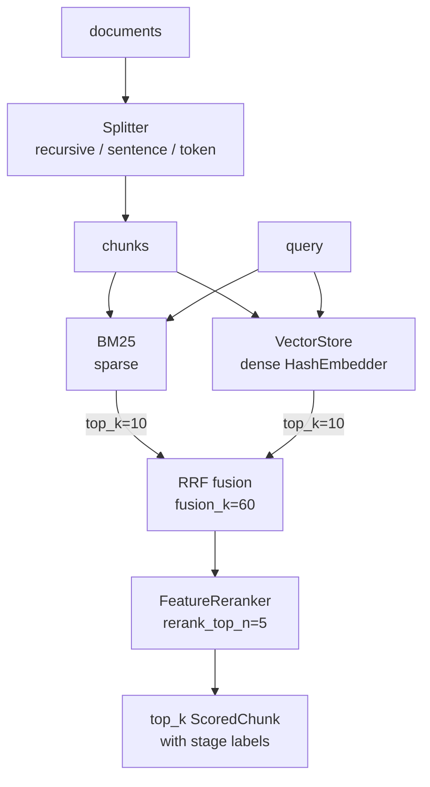

<p align="center">
  <em>Hybrid retrieval in Python: dense plus sparse, fused with RRF, re-ranked. No dependencies, no API calls.</em>
</p>

<p align="center">
  
  
  
</p>

---

Two indexes over the same documents — one on vectors, one on terms — then fuse the
rankings. Dense retrieval catches paraphrase; term matching catches the exact
identifier an embedding blurs away. Running both is what makes either one's blind
spot survivable.

## Quick start

```python
from beacon import RetrievalPipeline, Document

docs = [
    Document("Garbage collection in the JVM reclaims unreachable objects.", doc_id="d1"),
    Document("Python uses reference counting plus a cycle collector.",  doc_id="d2"),
    Document("The JVM heap is split into young and old generations.",   doc_id="d3"),
]

pipeline = RetrievalPipeline()
pipeline.index(docs)

hits = pipeline.search("how does the JVM collect garbage", top_k=2)
for h in hits:
    print(h.chunk.doc_id, round(h.score, 3))
```

```text
d1 0.424
d3 0.337
```

Note the argument name: `search(query, top_k=...)`. `k=` raises `TypeError`.

## The pieces

| Layer | Classes |
|---|---|
| Loaders | `load_text` · `load_markdown` · `load_jsonl` · `load_dir` |
| Splitting | `RecursiveCharacterSplitter` · `SentenceSplitter` · `TokenSplitter` |
| Sparse | `BM25(k1=1.5, b=0.75)` — `fit` · `search` |
| Dense | `VectorStore` + `HashEmbedder(dim=256)` |
| Fusion | `reciprocal_rank_fusion` — RRF, `fusion_k=60` by default |
| Re-ranking | `FeatureReranker` — weights per feature |
| Pipeline | `RetrievalPipeline` — `index` · `search` · `save_json` · `load_json` |
| Metrics | `recall_at_k` · `mean_reciprocal_rank` |

## Persistence

```python
pipeline.save_json("index.json")
restored = RetrievalPipeline.load_json("index.json")
```

The whole index — chunks, BM25 statistics, vectors — round-trips through one JSON
file. No database, no service.

## How a query flows



Each `ScoredChunk` carries a `stage` field, so you can tell whether a hit survived
on the sparse side, the dense side, or only after fusion.

## Install

Copy the `beacon/` directory into your project. No `pip install`, no dependencies.

## Tests

```bash
python -m pytest -q
```

61 tests.

## Limitations

- **`HashEmbedder` is a hashing bag-of-words, not a semantic model.** It rewards
  vocabulary overlap and cannot distinguish "the drug is safe" from "the drug is not
  safe". It exists so the pipeline runs fully offline; real recall needs a real
  embedding model plugged into the `Embedder` interface.
- **RRF scores are rank-based, so they are not comparable across queries.** Use the
  ordering, not the number, as a threshold.
- **The default BM25 has no field boosts or phrase queries.** One field per chunk.
- **In-memory only.** `save_json` writes the whole index; there is no incremental
  update or delete.
- **No recall/latency benchmarks published.** None were measured against a labelled
  set, so none are claimed.

## License

MIT
